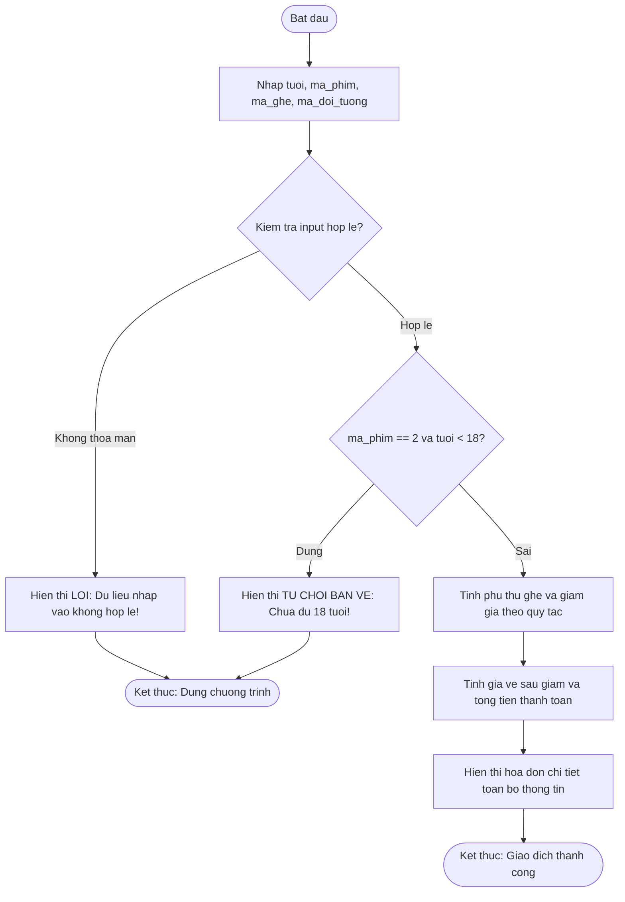

# Bao cao Bai tap 02: Xay dung Module Kiem Duyet Ve va Phan Loai Khan Gia Rap Chieu Phim

> 👤 **Học viên:** Hoàng Công Dũng | **Mã SV:** PTIT-HCM-009
> 🏫 **Môn học:** it102-rl-hoangcongdung

---

## 📊 Sơ đồ thiết kế hệ thống (Activity Diagram)

> 💡 *Sơ đồ dưới đây được render tự động trực tiếp trên GitHub bằng Mermaid. Bạn cũng có thể tải file **`bt2.drawio`** trong repository này để mở và chỉnh sửa trực tiếp trên [Draw.io (diagrams.net)](https://app.diagrams.net).* 

---

## Nhiệm vụ 1: Phân tích yêu cầu và Xây dựng cấu trúc dữ liệu

Trong bài thực hành này, em xây dựng một chương trình C hoàn chỉnh đóng vai trò là module cốt lõi cho Kiosk bán vé tự động tại rạp chiếu phim CGV. Bài toán đòi hỏi sự kết hợp chặt chẽ giữa việc kiểm chuẩn dữ liệu đầu vào (Input Validation) và áp dụng các quy tắc nghiệp vụ tài chính phức tạp.

Các biến được khai báo bao gồm tuoi (kiểu int) để lưu tuổi khán giả, ma_phim, ma_ghe, ma_doi_tuong (kiểu int) để lưu các mã phân loại tương ứng theo đúng đề bài.

- Sử dụng kiểu dữ liệu nguyên (int) cho các mã định danh và tuổi.
- Sử dụng kiểu dữ liệu thực (float) cho tính toán giá vé, tiền giảm giá và tổng tiền để đảm bảo độ chính xác.

## Nhiệm vụ 2: Viết mã nguồn chương trình C (main.c)

Dưới đây là mã nguồn hoàn chỉnh được viết cẩn thận, tuân thủ nghiêm ngặt các tiêu chuẩn cú pháp C, có kèm theo chú thích giải thích chi tiết cho từng khối logic xử lý.

- Đảm bảo kiểm tra lỗi dữ liệu đầu vào ngay từ bước đầu tiên để ngăn chặn ngoại lệ.
- Sử dụng switch-case cho việc tính phụ thu ghế và toán tử điều kiện cho việc giảm giá vé học sinh sinh viên.

## Nhiệm vụ 3: Kiểm thử các kịch bản thực tế (Test Cases)

Em đã tiến hành biên dịch và chạy thử chương trình trên môi trường Linux với lệnh 'gcc -Wall main.c -o main' và kiểm tra với các bộ dữ liệu mẫu.

| Kịch bản test | Dữ liệu đầu vào (Input) | Kết quả mong đợi (Output) | Trạng thái |
| --- | --- | --- | --- |
| Kịch bản 1 | Tuổi: 19, Phim: 2, Ghế: 2, Đối tượng: 2 | Hóa đơn hợp lệ, tổng tiền: 79000 VND | Đạt |
| Kịch bản 2 | Tuổi: 16, Phim: 2, Ghế: 1, Đối tượng: 2 | TU CHOI BAN VE: Khang gia chua du 18 tuoi de xem phim T18! | Đạt |
| Kịch bản 3 | Tuổi: 20, Phim: 1, Ghế: 5, Đối tượng: 1 | LOI: Du lieu nhap vao khong hop le! | Đạt |

---

## 📁 Danh sách tệp tin nộp bài trong Repository
- 📝 `bt2.docx`: Báo cáo tài liệu phân tích nghiệp vụ hoàn chỉnh.
- 🎨 `bt2.drawio`: File thiết kế sơ đồ chuẩn theo quy định đề bài (mở trực tiếp bằng [Draw.io](https://app.diagrams.net) hoặc Lucidchart).
- 💻 `main.c`: Mã nguồn chương trình.
